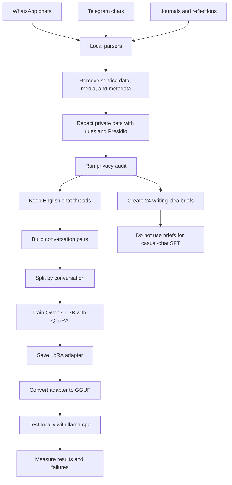

# Speak Like Me

I fine-tuned Qwen3-1.7B on my English chat messages to test if a small model
could learn my casual writing style. I built a private data pipeline, trained a
LoRA adapter, and ran it locally with llama.cpp. The model learned to produce
short replies. It gave poor results for LinkedIn posts and source rewriting.

## Architecture



I processed the exports on my computer. I did not add raw chats, cleaned
datasets, journals, or model files to this repository.

## Data pipeline

| Source | Use |
|---|---|
| Selected WhatsApp chats | Casual-chat examples |
| Selected Telegram chats | Casual-chat examples |
| Journals and reflections | 24 writing idea briefs; not used for chat training |
| Existing LinkedIn posts | Too few for a separate training dataset |

I collected 15,385 messages from five chat threads. I removed service messages,
media records, duplicate targets, targets without user context, long targets,
timestamps, and source names.

The redaction stage detected names, organizations, locations, contact details,
URLs, account values, payment-card numbers, passwords, one-time passwords, and
access tokens. Automated redaction can miss contextual private information.

One thread contained English and romanized Telugu. I excluded its 7,330
messages from the English v1 dataset. The final dataset contained 1,265 training
examples and 486 validation examples. I used one complete conversation for
validation.

## Training

I used `Qwen/Qwen3-1.7B` with QLoRA on a Colab T4 GPU. The main settings were:

| Setting | Value |
|---|---:|
| Training epochs | 2 |
| Maximum sequence length | 1,024 tokens |
| LoRA rank | 16 |
| LoRA alpha | 32 |
| LoRA dropout | 0.05 |
| Learning rate | 0.0001 |
| Loss | Assistant completion only |

Two training runs failed. The installed TRL version rejected one configuration
argument. The Qwen chat template also did not provide assistant-token masks. I
used an explicit prompt-and-completion format with completion-only loss. I also
kept the Colab PyTorch version to prevent CUDA package conflicts. Training then
completed.

## Results

The trained adapter was 69.8 MB. I converted it to a 34.9 MB GGUF adapter. I
loaded it with a Q4_K_M base model in llama.cpp. Local inference used about 2 GB
of memory and generated about 39 tokens per second on my laptop CPU.

For 100 held-out casual prompts, historical replies had a median length of 10
words. The base-model median was 35.5 words. The SFT-model median was 8 words.
The adapter learned reply length. I have not completed a human quality review,
so this result does not prove that it learned my full style.

## Example failures

| Test conversation | SFT response | What failed | Probable cause |
|---|---|---|---|
| **User:** “write me a linkedin post on transformer architecture”<br><br>**User:** “where is the post?” | “Hey everyone, this is a post on how transformer architecture is different from RNN/LSTM.”<br><br>“I will write it and post it. You can view it directly from the &lt;URL&gt;” | The model wrote only an introduction. It then claimed that it would publish the post and invented a URL placeholder. | The training data had short chat replies and no LinkedIn task examples. |
| **User:** “can u turn this to a linkedinpost?”<br><br>The prompt included an article about security risks for AI agents. | The model put the supplied article inside `<LinkedInPost>` tags. After a correction, it repeated almost the same article. | The model copied the source instead of writing a new post. | The training data had no source-to-post examples. |

I also tested the same source with a direct rewrite instruction. The base model
produced a usable multi-paragraph rewrite. The SFT model produced only the title
“Security Risks of AI Agents.” The adapter loaded correctly. The narrow casual
dataset caused the failure.

## Limitations and current status

- The model has 1.7 billion parameters and limited capacity.
- Fifty-six percent of the training replies had 10 words or fewer.
- The validation data came from one conversation.
- The mixed-language thread was excluded in full.
- No LinkedIn model has been trained.
- No preference optimization has been performed.
- The adapter can retain information from its private training data. I did not
  publish it.

The current adapter is an experimental casual-chat checkpoint. It is not a
general writing model. Preference optimization is the planned next experiment.

## Code

Run the tests with synthetic data:

```bash
PYTHONPATH=src python -m unittest discover -s tests -v
```

The repository includes the redaction code, dataset builders, training scripts,
Colab notebooks, local llama.cpp launchers, and synthetic test fixtures. See
[the privacy pipeline reference](docs/privacy-pipeline.md) for the detailed
commands.
