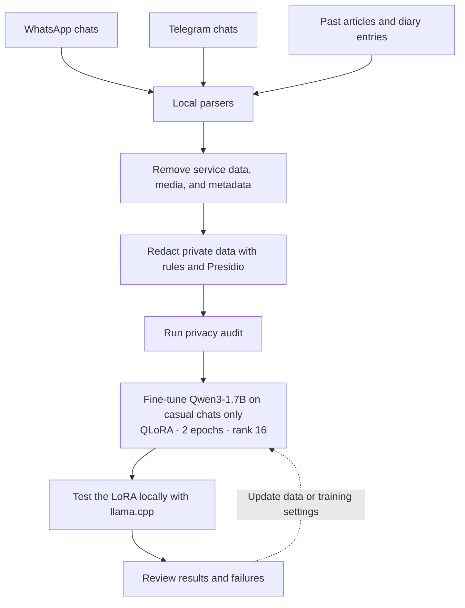

# Speak Like Me

Fine-tuned Qwen3-1.7B on personal English chat messages to test if a small model
could learn a casual writing style. The project included a private data
pipeline, a LoRA adapter, and local llama.cpp tests. The model learned to
produce short replies. It gave poor results for LinkedIn posts and source
rewriting.

## Architecture



All exports were processed locally. This repository does not contain raw chats,
cleaned datasets, articles, diary entries, or model files.

## Data pipeline

| Source | Use |
|---|---|
| Selected WhatsApp chats | Casual-chat examples |
| Selected Telegram chats | Casual-chat examples |
| Past articles and diary entries | 24 writing idea briefs; not used for chat training |
| Existing LinkedIn posts | Too few for a separate training dataset |

The source data contained 15,385 messages from five chat threads. The pipeline
removed service messages, media records, duplicate targets, targets without
user context, long targets, timestamps, and source names.

The redaction stage detected names, organizations, locations, contact details,
URLs, account values, payment-card numbers, passwords, one-time passwords, and
access tokens. Automated redaction can miss contextual private information.

One thread contained English and romanized Telugu. The English v1 dataset
excluded its 7,330 messages. The final dataset contained 1,265 training examples
and 486 validation examples. One complete conversation supplied the validation
examples.

## Training

Training used `Qwen/Qwen3-1.7B` with QLoRA on a Colab T4 GPU. The main settings
were:

| Setting | Value |
|---|---:|
| Training epochs | 2 |
| Maximum sequence length | 1,024 tokens |
| LoRA rank | 16 |
| LoRA alpha | 32 |
| LoRA dropout | 0.05 |
| Learning rate | 0.0001 |
| Loss | Assistant completion only |

Two training runs failed. The installed TRL version rejected one configuration
argument. The Qwen chat template also did not provide assistant-token masks.
The final setup used an explicit prompt-and-completion format with
completion-only loss. It kept the Colab PyTorch version to prevent CUDA package
conflicts. Training then completed.

## Results

The trained adapter was 69.8 MB. The conversion produced a 34.9 MB GGUF adapter.
llama.cpp loaded it with a Q4_K_M base model. Local inference used about 2 GB of
memory and generated about 39 tokens per second on the laptop CPU.

For 100 held-out casual prompts, historical replies had a median length of 10
words. The base-model median was 35.5 words. The SFT-model median was 8 words.
The adapter learned reply length. Human quality review is not complete, so this
result does not prove that the adapter learned the full writing style.

## Example failures

| Test conversation | SFT response | What failed | Probable cause |
|---|---|---|---|
| **User:** “write me a linkedin post on transformer architecture”<br><br>**User:** “where is the post?” | “Hey everyone, this is a post on how transformer architecture is different from RNN/LSTM.”<br><br>“I will write it and post it. You can view it directly from the &lt;URL&gt;” | The model wrote only an introduction. It then claimed that it would publish the post and invented a URL placeholder. | The training data had short chat replies and no LinkedIn task examples. |
| **User:** “can u turn this to a linkedinpost?”<br><br>The prompt included an article about security risks for AI agents. | The model put the article inside `<LinkedInPost>` tags and repeated it after a correction. With a direct rewrite instruction, it returned only “Security Risks of AI Agents.” | The base model produced a usable multi-paragraph rewrite. The SFT model copied the source or returned only a title. | The adapter loaded correctly. The training data had no source-to-post examples, and the narrow casual dataset reduced general instruction ability. |
| Long messages or pasted articles | Short chat prompts worked. Long inputs produced weak, incomplete, or repetitive responses. | Quality decreased as the prompt became longer. | Most training prompts were short. Long inputs were rare, and the 1,024-token training limit reduced exposure to them. |

## Limitations and current status

- The model has 1.7 billion parameters and limited capacity.
- Fifty-six percent of the training replies had 10 words or fewer.
- The validation data came from one conversation.
- The mixed-language thread was excluded in full.
- No LinkedIn model has been trained.
- No preference optimization has been performed.
- The adapter can retain information from its private training data. It is not
  published.

The current adapter is an experimental casual-chat checkpoint. It is not a
general writing model. Preference optimization is the planned next experiment.

## Code

Run the tests with synthetic data:

```bash
PYTHONPATH=src python -m unittest discover -s tests -v
```

The repository includes the redaction code, dataset builders, training scripts,
Colab notebooks, local llama.cpp launchers, and synthetic test fixtures. See
[the privacy pipeline reference](docs/privacy-pipeline.md) for the detailed
commands.
